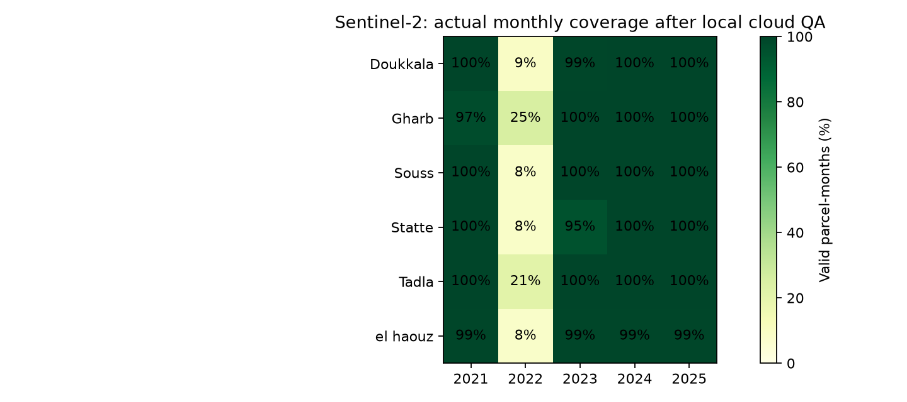
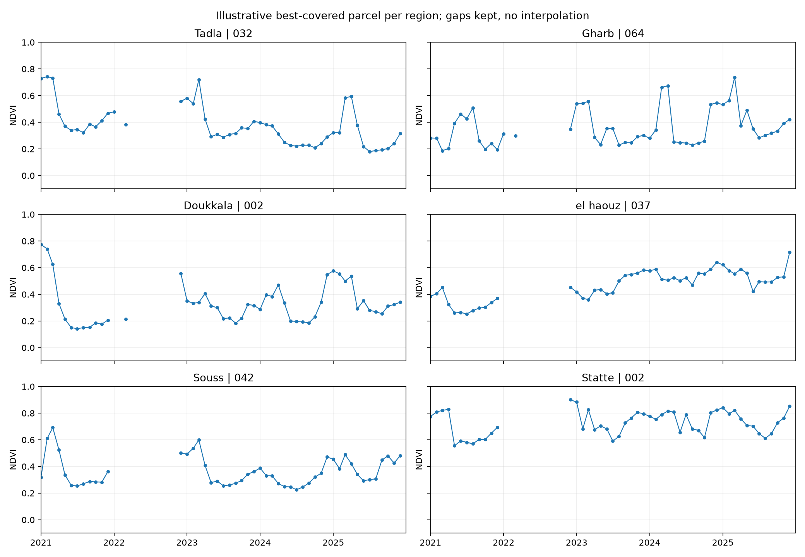

# Historique Sentinel-2 étendu des oliveraies

État : **extraction terminée**.

Période demandée : janvier 2021 – décembre 2025. **563 parcelles**, 60 mois, 33,780 emplacements calendaires. **27,657 observations acceptées** sur **561 parcelles** après contrôle local. Les emplacements calendaires ne sont pas des mesures. 754 fichiers de découpes vérifiés par SHA-256.

## Couverture réelle

| year | calendar | valid | coverage_percent |
| --- | --- | --- | --- |
| 2021 | 6756 | 6726 | 99.56 |
| 2022 | 6756 | 758 | 11.22 |
| 2023 | 6756 | 6720 | 99.47 |
| 2024 | 6756 | 6728 | 99.59 |
| 2025 | 6756 | 6725 | 99.54 |





## Méthode

Polygones complets d'oliveraies documentées ; géométries valides, absence de culture intercalaire déclarée. Source terrain : https://doi.org/10.6084/m9.figshare.28486022.v2 .

Sentinel-2 Collection 1 L2A via Earth Search v1, collection `sentinel-2-c1-l2a`. Pour chaque parcelle et mois, scènes couvrant le polygone complet et au plus 40 % de nuages de scène, classées par nuages puis date et identifiant. Jusqu'à deux candidats : le second est essayé si le premier échoue au contrôle local ou à la lecture. Ce sont des observations mensuelles sélectionnées, pas des composites ni des moyennes mensuelles de toutes les scènes.

Bandes B4 et B8 natives à 10 m, conversion en réflectance par les `scale`/`offset` STAC. SCL à 20 m rééchantillonnée au plus proche à 10 m. Seules les classes 4 et 5 sont retenues. Au moins neuf centres de pixels dans le polygone et au moins 60 % de pixels localement valides après masque de nuages et contrôle de réflectance. NDVI et SAVI sont calculés par pixel, puis moyennés sur le polygone. Les petits polygones et bords restent sensibles aux pixels mixtes.

Les dates d'acquisition, produits, fractions valides, raisons de rejet et références des découpes restent dans le CSV. Les mois sans mesure valide restent NaN. Aucune interpolation, aucun label de stress créé. Les erreurs de la dernière exécution figurent dans `errors.json`, celles d'exécutions reprises dans `error_history.json` ; elles ne doivent pas être confondues avec une absence de scène.

Contrôle de cohérence avec les séries publiées en 2024, sur exactement les mêmes parcelles et jours : **4872 correspondances**, écart absolu moyen de NDVI **0.00139**, médiane **0.00063**, 95e percentile **0.00525**. Les deux traitements ne sont pas nécessairement identiques (grille, QA et agrégation). Ce contrôle vérifie la cohérence de traitement ; il n'évalue pas la détection de stress et ne constitue pas une validation terrain indépendante.

## Utilisation pour le sujet

Ce jeu sert directement à l'analyse satellitaire multi-temporelle : trajectoires NDVI, saisonnalité, prévision du prochain NDVI et changements de végétation. Il remplace la profondeur d'une seule année par une grille de cinq années pour de nombreuses parcelles.

Pour une comparaison séquentielle stricte : six mois d'entrée, prévision du mois suivant ; mêmes origines pour Random Forest, XGBoost, LightGBM, LSTM, GRU et CNN-LSTM. Le split 70/15/15 de la grille donne train janvier 2021–juin 2024, validation juillet 2024–mars 2025, test avril–décembre 2025. Fenêtres entièrement dans chaque bloc, sans combler les trous. Disponibilité brute avant exclusion de parcelles indépendantes : **{'test': 1678, 'train': 10663, 'validation': 1680}**. Une fenêtre sur douze mois ne tient pas entièrement dans les blocs validation/test de neuf mois ; utiliser six mois ou définir explicitement une évaluation avec contexte passé causal.

Les parcelles réservées à l'évaluation spatiale doivent être exclues du train et de la validation ; leurs résultats doivent être présentés à part. Les limites d'exploitation et bassins ne sont pas connus, donc des parcelles distinctes ne garantissent pas une indépendance agronomique.

Audit géométrique : **4 paires de polygones fortement superposés** (IoU ou fraction de recouvrement du petit polygone ≥ 80 %), regroupées en **559 groupes spatiaux**. Pour les splits, conserver les membres d'un même groupe ensemble et ne pas compter des polygones superposés comme observations indépendantes. Voir `strong_polygon_overlaps.csv` et `spatial_groups.csv`. Ce regroupement n'identifie pas les exploitations.

## Limites

La culture a été observée aux dates de visite indiquées dans les métadonnées, pas continuellement entre 2021 et 2025. Vérifier plantations, arrachages et changements de culture avant d'interpréter tout l'historique comme une oliveraie stable. Les trous de catalogue, notamment en 2022, restent visibles. Un changement de NDVI ne prouve pas un stress hydrique ; cette attribution demande des observations terrain sur les mêmes parcelles et dates. Le NDVI est un indice de végétation et non une mesure directe de santé. Les séries publiées de 2024 ne sont pas empilées comme exemples indépendants avec ces nouvelles extractions.

L'échantillon est déséquilibré : **415/563 polygones dans el haouz**. Il ne représente pas toutes les oliveraies marocaines. Rapporter aussi les performances par région et par groupe spatial, sans assimiler des polygones voisins à des exploitations indépendantes.

## Fichiers et reproduction

- `data/processed/sentinel_history_2021_2025/monthly_history.csv` : historique et calendrier.
- `data/processed/sentinel_history_2021_2025/parcels.geojson` : polygones retenus.
- `data/processed/sentinel_history_2021_2025/status.json` : état réel de l'import.
- `data/raw/sentinel_history_2021_2025/` : catalogues, découpes et calibration/provenance.
- `outputs/sentinel_history_2021_2025/` : couverture, graphiques, fenêtres et manifeste vérifié.

```powershell
.venv/Scripts/python.exe tools/extend_sentinel_history.py --workers 8
.venv/Scripts/python.exe tools/report_sentinel_history.py
```

L'import reprend uniquement les découpes de la bonne version avec empreinte correcte. Les notebooks 01/02 et leurs résultats antérieurs ne sont pas remplacés. Aucun entraînement n'est réalisé par cette extension.
